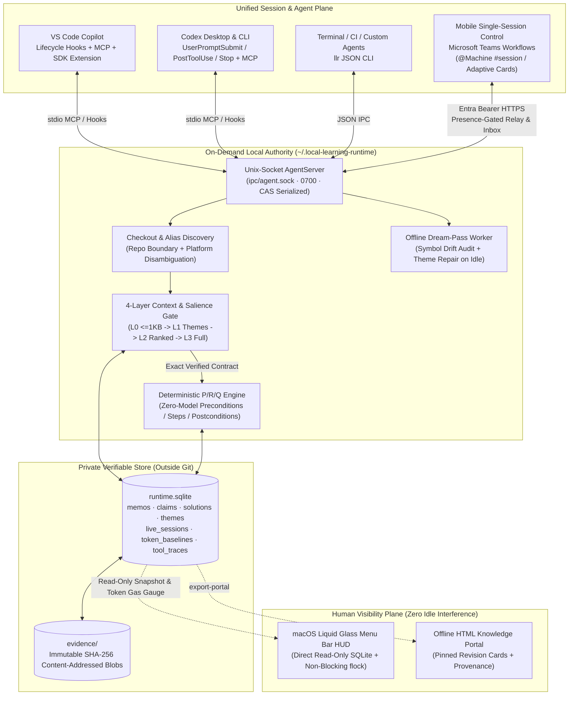
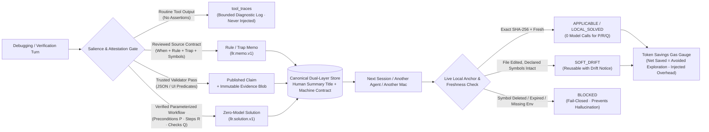
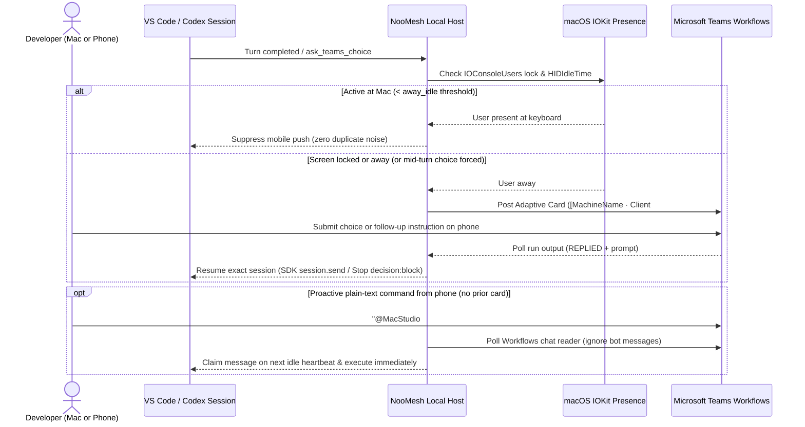
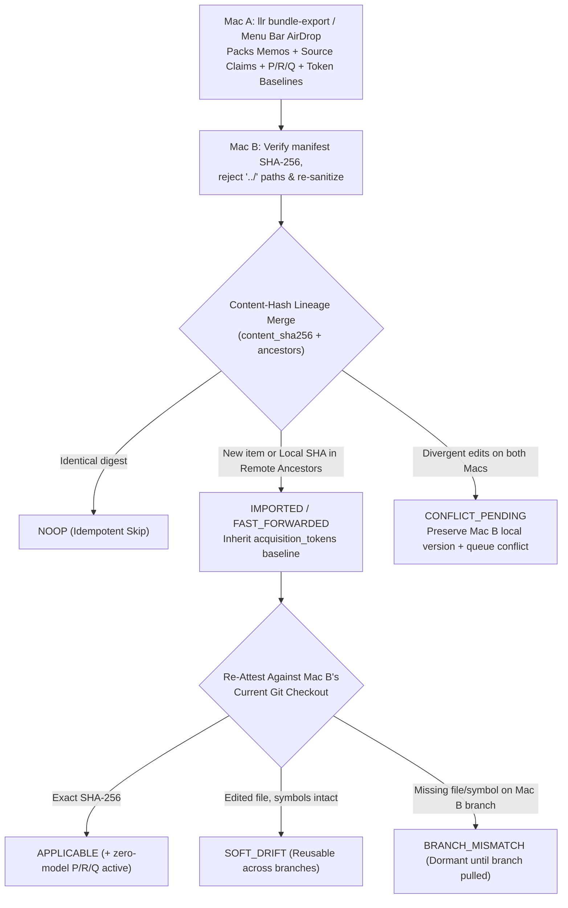

# NooMesh

**NooMesh — Human-readable doctrine. Machine-executable contracts. One session across every Mac and agent.**

Most coding-agent "memory" features are invisible, single-vendor prose scratchpads: you cannot see when a memory fired, you cannot share it across VS Code Copilot, Codex, and terminal agents, and you have no protection when source code changes turn yesterday's note into today's hallucination.

**NooMesh** is a local-first, zero-dependency experience engine and cross-agent command mesh. Every piece of engineering wisdom lives as a **single canonical record with two synchronized faces**:
- **For Humans**: crisp `<Phenomenon / Scenario>: <Root Cause & Actionable Conclusion>` titles, a native macOS **Liquid Glass Menu Bar HUD**, live source-integrity lights, and a **Token Savings Gas Gauge** proving exact ROI.
- **For Machines**: symbol-anchored `When / Rule / Trap / Verification` guardrails, epistemic salience gating (`L0 → L1 → L2 → L3`), and deterministic **zero-model `P/R/Q` contracts** (`Preconditions → Steps → Postconditions`) shared across every local agent and re-attested safely across every Mac.

---

## Current Capabilities

- **Dual-Layer Experience Doctrine (`Memo`, `Claim`, `Solution`)**
  - **Closed-Loop Rule & Trap Memos (`llr.memo.v1`)**: Capture architectural boundaries and debugging pitfalls as `When + Rule + Trap + Verification`, anchored to repo-relative file `SHA-256` digests and symbol invariants (`class`, `fun`, `object`, etc.).
  - **Evidence-Backed Claims**: Publish observations only when registered local predicates (`json_equals`, unique UI node selectors) pass against immutable, content-addressed evidence blobs.
  - **Zero-Model `P/R/Q` Solution Contracts (`llr.solution.v1`)**: Compile repeatable read-only checks and pre-authorized validator workflows into typed-enum parameterized procedures that execute locally with `model_calls = 0`.
  - **Enforced Human-Readable Title Standard**: Every doctrine and session title follows `<Phenomenon / Scenario>: <Root Cause or Core Rule>`—rejecting bare URLs and raw predicate dumps at publication time.
- **4-Layer Progressive Memory & Salience Gating (`L0 → L1 → L2 → L3`)**
  - **Compact `L0` Session Index (`<= 1024 B`)**: `sessionStart` injects only workspace counts, sharded theme pointers, explicit preferences, and up to two top title pointers—automatically silenced on unrelated prompts inside monorepo parent roots.
  - **Epistemic `L2` Ranking**: Ranks candidates by verification strength (`verified solution > active claim/memo > SOFT_DRIFT > BLOCKED warning > unverified legacy > candidate`) within strict UTF-8 byte budgets (`6 KB` default, `12 KB` max).
  - **Lexical Salience Gate (`relevance_score`)**: Blocks single-stopword and generic-filler false positives (`no`, `PR`, `debug`, `fix`, `UI`) so unrelated rules never pollute context or inflate hit metrics.
  - **Noise Stop-Bleeding (`tool_traces`)**: Isolates routine `postToolUse` receipts in a lightweight trace table instead of polluting candidate memory, with `llr prune-noise --approve --vacuum` for instant storage compaction.
- **Resilient Symbol Anchors & Portable `.noomesh` AirDrop Sharing (`llr bundle-*`)**
  - Separates repo-relative source paths and declared symbols from machine-local checkout paths, packaging `Memos`, source-anchored `Claims` (+ immutable evidence blobs), `P/R/Q Solutions`, `L1 Themes`, and `acquisition_tokens` baselines into a single deterministic `.noomesh` archive with zero absolute-path or secret leakage.
  - One-click **AirDrop** share (`NSSharingService(.sendViaAirDrop)`) and `.noomesh` import directly from the macOS Menu Bar HUD: the receiving Mac verifies `manifest.json` `SHA-256` digests, merges content-hash lineages (`NOOP` / `FAST_FORWARDED` / non-destructive `CONFLICT_PENDING`), re-attests anchors against its own local branch (`APPLICABLE` / `SOFT_DRIFT` / `BRANCH_MISMATCH`), and downgrades external-runner contracts until locally re-approved.
- **Deterministic Offline Consolidation (`llr dream-pass` & Idle Auto-Dream)**
  - Audits symbol-anchor drift, repairs sharded `L1` theme links with optimistic CAS and bloat warnings, and surfaces sanitized `fail -> pass` debugging turnarounds—running with zero LLM calls via CLI, MCP (`local_learning_dream`), or automatically before the Host's 10-minute idle shutdown (`--auto-dream-source`).
- **Native macOS Liquid Glass Menu Bar HUD (`llr menubar-*`)**
  - Standalone zero-Dock-icon AppKit + SwiftUI floating glass panel (`NSGlassEffectView` on macOS 26+ with `NSVisualEffectView` fallback, crowned by a custom **Throne-Crown, Doctrine-Tome & Contract-Cog** template emblem).
  - Displays stable, anti-jitter **Active Session Tasks** (auto-extracting clean titles from Copilot/Codex metadata and compacting PR/Bug/IcM URLs), exact local doctrine invoked per session, chronological learning/hit feeds, **click-to-inspect full doctrine detail** with one-click Markdown copy and *Open in VS Code* source links, plus one-click offline HTML portal export and `dream-pass` triggers.
  - Queries SQLite read-only and checks `host-owner.lock` via non-blocking `flock` so UI refreshes never wake a sleeping Host or reset its idle timer.
- **Token Savings Gas Gauge & Per-Item Ledger**
  - Tracks acquisition token cost (automatically captured from incremental non-cached Copilot turn telemetry, or computed conservatively from bounded source anchors and evidence blobs) against injected payload overhead.
  - Renders a 240° radial **Gas Gauge** (cumulative net saved tokens, 24h delta, acquisition investment, ROI multiple, and next milestone target), deduplicates shared source anchors within the same retrieval batch, and shows a 4-cell Token Ledger on every doctrine item.
- **Single-Session Command & Mobile Relay (`Teams Workflows` + Multi-Mac)**
  - **Presence-Aware Continuation (`--away-only`)**: Queries macOS `IOConsoleUsers` screen-lock state and `HIDIdleTime` so local turns stay silent while you are actively typing at your Mac, and seamlessly switch to Microsoft Teams Adaptive Cards (`PostCardAndWaitForResponse` with Entra ID `az` Bearer auth) when your screen locks or goes idle.
  - **Mid-Turn Mobile Decisions**: Send radio-button + free-text Adaptive Cards mid-turn from VS Code (`ask_teams_choice`) or any MCP client (`local_learning_ask_choice`) and resume execution immediately upon mobile reply.
  - **Proactive Chat Router & Multi-Mac Isolation (`llr inbox-*`)**: Type plain messages directly into your private Teams `Workflows` chat (`@MachineName`, `#sessionPrefix`, `/sessions`, `/new`) to steer matching idle sessions or spawn bounded sessions across multiple Macs sharing one Teams account.
- **Zero-Dependency, Private-by-Default Core & Bounded Missions**
  - Pure Python 3.9+ standard library (`dependencies = []`), `0700` private state home (`~/.local-learning-runtime`), deterministic HMAC secret/PII redaction, and approval-gated active-learning missions with hard-capped model budget reservations.

---

## One-Click Agent Install Prompt

Copy the prompt below and paste it directly into **VS Code Copilot Chat**, **Codex**, or **Claude Code** on any Mac (or Linux workstation) to install NooMesh, wire your local client hooks and MCP server, and launch the menu bar HUD automatically:

```text
Install and configure NooMesh (https://github.com/yuzhongqi/NooMesh.git) on this machine for my current workspace by executing these exact steps:

1. Clone https://github.com/yuzhongqi/NooMesh.git into "$HOME/Developer/NooMesh" (or run `git -C "$HOME/Developer/NooMesh" pull --ff-only` if it already exists).
2. Create an isolated Python 3.9+ virtual environment at "$HOME/.local/share/noomesh/venv", upgrade `pip setuptools wheel`, and install "$HOME/Developer/NooMesh" (`pip install .`).
3. Detect my current repository root (`git rev-parse --show-toplevel`, or current working directory if not in Git), infer a clean `<project>/<platform>` workspace ID (`platform` in `android`, `ios`, or `generic`), and ask me only if the platform is genuinely ambiguous.
4. Register this workspace and install the local adapters using `$HOME/.local/share/noomesh/venv/bin/llr`:
   - If `~/.copilot` exists (or VS Code Copilot is used), run:
     `$HOME/.local/share/noomesh/venv/bin/llr setup "<workspace_id>" --root "<repo_root>" --platform "<platform>" --client copilot --approve`
   - If `~/.codex` exists, also run `--client codex --approve` (and `--client codex-hooks --approve` if `~/.codex/hooks.json` has no conflicting custom hooks).
5. Enable offline idle auto-consolidation on the workspace:
   `$HOME/.local/share/noomesh/venv/bin/python -c "from pathlib import Path; from local_learning_runtime.core import Store; from local_learning_runtime.learning import authorize; s = Store(Path.home()/'.local-learning-runtime'); authorize(s, ['<workspace_id>'], True, auto_dream_source=True); s.close()"`
6. If running on macOS (`uname -s == Darwin`) with Xcode / CommandLineTools Swift (`xcrun swiftc`), build and launch the native Liquid Glass Menu Bar HUD with login auto-start:
   `$HOME/.local/share/noomesh/venv/bin/llr menubar-start --install-login-agent --approve`
7. Run `$HOME/.local/share/noomesh/venv/bin/llr host-status` and `$HOME/.local/share/noomesh/venv/bin/llr doctor`, report the workspace ID, state home, MCP config path, and menu bar PID, and remind me to reload my IDE window once so the newly registered `local_learning` MCP server and lifecycle hooks take effect.
```

### Manual CLI Quickstart

If you prefer running the setup directly in your terminal:

```sh
mkdir -p "$HOME/Developer"
git clone https://github.com/yuzhongqi/NooMesh.git "$HOME/Developer/NooMesh"
cd "$HOME/Developer/NooMesh"

python3 -m venv "$HOME/.local/share/noomesh/venv"
"$HOME/.local/share/noomesh/venv/bin/python" -m pip install --upgrade pip setuptools wheel
"$HOME/.local/share/noomesh/venv/bin/python" -m pip install .

# Register your project and wire VS Code Copilot (or --client codex / codex-hooks)
"$HOME/.local/share/noomesh/venv/bin/llr" setup my-app/generic \
  --root /absolute/path/to/your/repo \
  --platform generic \
  --client copilot \
  --approve

# On macOS: compile & launch the top-right Liquid Glass Menu Bar HUD + login LaunchAgent
"$HOME/.local/share/noomesh/venv/bin/llr" menubar-start --install-login-agent --approve

# Verify daemon health and adapter handoffs
"$HOME/.local/share/noomesh/venv/bin/llr" host-status
"$HOME/.local/share/noomesh/venv/bin/llr" doctor
```

---

## Implementation Principles & Architecture

### 1. System Topology: Shared Local Host & Multi-Agent / Multi-Mac Mesh

NooMesh runs an **on-demand, user-private Unix-domain socket daemon** (`~/.local-learning-runtime/ipc/agent.sock`, permissions `0700`). Every IDE hook, MCP stdio bridge, CLI call, and Teams relay talks to the same serialized authority—while the macOS Liquid Glass HUD observes SQLite read-only without disturbing the Host's 10-minute idle lifecycle.



### 2. Dual-Layer Doctrine Lifecycle: From Debugging Turn to Zero-Model Reuse

Instead of dumping raw chat transcripts into a vector store, NooMesh enforces **strict salience separation at ingestion** and **cryptographic anchor verification at retrieval**:



### 3. Presence-Aware Mobile Continuation & Multi-Mac Routing

When you step away from your desk, NooMesh lets a single mobile Teams `Workflows` chat act as a remote command console across all your Macs—while automatically staying silent whenever you are actively using the keyboard/trackpad at that Mac:



---

### 4. Core Architectural Mechanisms

#### A. One Record, Two Synchronized Layers
Human explanations and machine execution steps never drift apart because both are projected from the exact same versioned JSON/SQLite record:

| Dimension | Human Layer (Menu Bar HUD & HTML Portal) | Machine Layer (MCP / Hooks / Local Executor) |
|---|---|---|
| **Identity & Intent** | `<Phenomenon / Scenario>: <Root Cause or Rule>` summary title | `workspace`, `platform`, `tags`, lexical salience tokens, `problem.patterns` |
| **Applicability** | Clear scope chips & environment labels | Typed `conditions`, `file_sha256` preconditions, pinned dependency versions |
| **Action / Guidance** | Scannable `When / Rule / Trap` cards | Bounded `inspect_file` / `run_validator` / `select` / `branch` steps (no arbitrary `eval`) |
| **Trust & Integrity** | Live green/amber/red status dot (`Consistent` / `Soft Drift` / `Blocked`) + source links | `SHA-256` file digest + declared symbol survival check + immutable evidence check |
| **Economic Proof** | 240° **Token Savings Gas Gauge** + 4-cell per-item Token Ledger | Measured turn telemetry (`input - cacheRead + output`) minus injected token overhead |

#### B. Resilient Symbol Anchors (`PASS` vs `SOFT_DRIFT` vs `BLOCKED`)
Pure `SHA-256` file pinning breaks the moment someone adds an unrelated method or comment to a 1,500-line file, whereas unanchored prose silently rots when an API is refactored. NooMesh solves both with `llr anchor <workspace> <file> --symbol <identifier>`:
- **`PASS`**: File `SHA-256` matches the verified baseline and freshness policy (`memory_policies`) is valid.
- **`SOFT_DRIFT`**: File `SHA-256` changed due to edits elsewhere in the file, **but every declared symbol still exists** in the file—knowledge remains usable with an explicit drift notice, and `llr dream-pass --apply --approve` can re-anchor it offline with zero LLM calls.
- **`BLOCKED`**: Any declared symbol was removed/renamed, evidence failed integrity checks, or the freshness window expired—NooMesh fails closed and warns the agent instead of feeding stale advice.

#### C. Honest Token Savings Accounting
NooMesh never fabricates arbitrary "tokens saved" numbers:
1. **Acquisition Baseline**: Recorded from explicit `--acquisition-tokens` / `llr token-record`, incremental non-cached Copilot turn telemetry (`events.jsonl` bounded step deltas), or conservative workspace anchor file inspection windows (capped at `32 KB` per file + tool roundtrip overhead).
2. **Net Marginal Reuse**: `saved_tokens = max(0, acquisition_tokens - injected_tokens)` (`injected_tokens = 0` for zero-model `P/R/Q` executions).
3. **Shared-Anchor Deduplication**: If a single turn retrieves both a `Memo` and a `Claim` anchored to the same `.kt` / `.py` / `.ts` source files, overlapping source files are counted **once** per turn batch—never double-counted.

#### D. Portable `.noomesh` Doctrine Bundles & Cross-Mac Lineage Merge
Sharing raw `runtime.sqlite` files across machines leaks absolute paths, overwrites peer discoveries, and bypasses branch verification. Instead, `llr bundle-export` compiles a deterministic, single-file `.noomesh` archive (`manifest.json` + `doctrine/*.json` + `evidence/*.blob`) stripped of machine-local paths, session heartbeats, and runner trust grants:



---

## Essential CLI & MCP Reference

### Everyday CLI Commands

```sh
# Workspace & client lifecycle
llr setup <workspace> --root <path> --platform <android|ios|generic> --client <copilot|codex|codex-hooks> --approve
llr register-alias --workspace <workspace> --root <monorepo_parent> --require-platform --approve
llr host-status
llr doctor
llr host-stop

# Authoring & consolidating dual-layer doctrine
llr anchor <workspace> <relative_file_path> --symbol "<symbol_declaration>"
llr memo-propose /private/path/memo.json --expected-version 0 --approve
llr solution-propose /private/path/solution.json --expected-version 0 --approve
llr dream-pass --workspace <workspace> --apply --approve
llr prune-noise --approve --vacuum

# Progressive retrieval & zero-model routing
llr search --cwd <path> --query "<task>" --session <session_id>
llr context --cwd <path> --query "<task>" --session <session_id> --level <0|1|2|3>
llr route --cwd <path> --query "<exact_task>" --session <session_id>

# Cross-Mac portable .noomesh AirDrop export, inspection, import & conflict check
llr bundle-export --workspace <workspace> --output ~/Desktop/team-doctrine.noomesh --approve
llr bundle-inspect ~/Downloads/team-doctrine.noomesh
llr bundle-import ~/Downloads/team-doctrine.noomesh --workspace <workspace> --approve
llr bundle-conflicts --workspace <workspace>

# macOS Liquid Glass Menu Bar HUD & offline HTML portal
llr menubar-start --install-login-agent --approve
llr menubar-status
llr menubar-hits --hours 24
llr menubar-open-portal --workspace <workspace>
llr menubar-stop
llr session-title --session <session_id> --title "<Phenomenon>: <Root cause / task summary>"

# Optional Microsoft Teams mobile relay & proactive router
pbpaste | llr relay-config --webhook-stdin --env-id "<ENV_ID>" --flow-id "<FLOW_ID>" \
  --machine-name "MacStudio" --away-only --away-idle 60 --auto-on-stop --approve
pbpaste | llr inbox-config --reader-stdin --poll-seconds 6 --default-cwd "<path>" --allow-new-sessions --approve
```

### Exposed MCP Tools (`local_learning` server)

| MCP Tool | Purpose |
|---|---|
| `local_learning_search` | Salience-gated search across `Memo`, `Claim`, and candidate milestones for the discovered workspace. |
| `local_experience_context` | Progressive `L0 / L1 / L2 / L3` memory packets with pinned knowledge revisions and byte-bounded pagination. |
| `local_experience_route` | Deterministic check whether an approved `P/R/Q` contract covers the exact request and parameter enum. |
| `local_experience_execute` | Execute a verified `P/R/Q` contract locally (`model_calls = 0`) with full pre/postcondition proof recording. |
| `local_learning_dream` | Read-only offline consolidation report (symbol-anchor drift, theme link/bloat checks, `fail -> pass` episodes). |
| `local_learning_maintenance` | Inspect aging items, freshness windows, and observed reuse priorities. |
| `local_learning_validators` / `local_learning_validate` | Discover and execute pre-authorized app/workspace validators with automatic evidence & claim publication. |
| `local_learning_status` | Inspect task-run milestone capture and publication state. |
| `local_learning_ask_choice` | Dispatch an interactive Adaptive Card to Teams Workflows and await a mobile decision across Macs & IDEs. |

---

## Explicit Trust & Safety Boundaries

- **Ships generic engine code, never personal memories**: `runtime.sqlite`, `evidence/`, `portal-live/`, webhook configurations, and logs live strictly under private `0700` `~/.local-learning-runtime` outside Git. Attempting to initialize a state directory inside a Git repository is rejected.
- **Local storage vs. cloud prompt injection**: `P/R/Q` contract execution (`llr solution-execute` and Codex `--local-first-readonly` gates) performs zero model calls; when an IDE injects retrieved `L0/L2` summaries into a cloud-hosted model, those sanitized summaries are sent to your configured model provider.
- **Similarity never authorizes execution**: Fuzzy search surfaces context for human/agent judgment; automated `P/R/Q` execution requires an exact pattern match, approved enum parameters, and passing live preconditions.
- **Multi-Mac portability requires local re-attestation**: Never copy a live running SQLite file across machines while active. Exported or synced doctrine carries repo-relative anchors and must pass local checkout verification (`PASS` / `SOFT_DRIFT`) on the receiving Mac before reuse.

---

## Development & Verification

Pure Python 3.9+ with zero third-party runtime dependencies:

```sh
python3 -m unittest discover -s tests -v
python3 -m examples.demo
python3 -m examples.agent_demo
python3 -m examples.lifecycle_demo --output /tmp/noomesh-lifecycle
```
